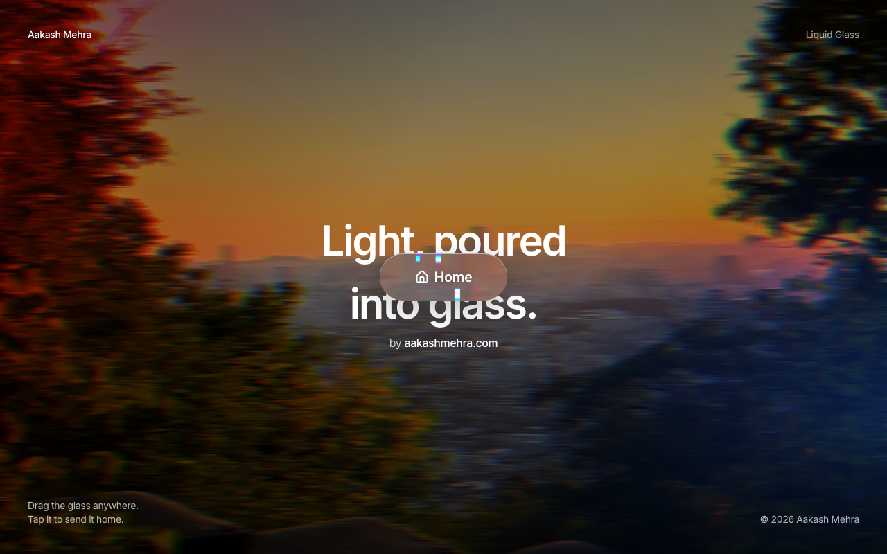

# Liquid Glass Button

A draggable "Home" pill made of liquid glass, by [Aakash Mehra](https://aakashmehra.com).



A displacement map bends the light behind the pill through an SVG backdrop filter, with chromatic fringes at the rim. Drag it anywhere on the page; tap it and it springs back home. Safari and Firefox don't support SVG filters in `backdrop-filter`, so they get a frosted glassmorphism fallback.

## Run

```bash
npm install
npm run dev
```

Open http://localhost:3000.

## Files

- `components/ui/liquid-glass.tsx`: the glass surface.
- `components/ui/demo.tsx`: the draggable Home pill over a motion-blurred photo.

Built with Next.js, TypeScript, Tailwind CSS v4, shadcn/ui, Motion and lucide-react.
